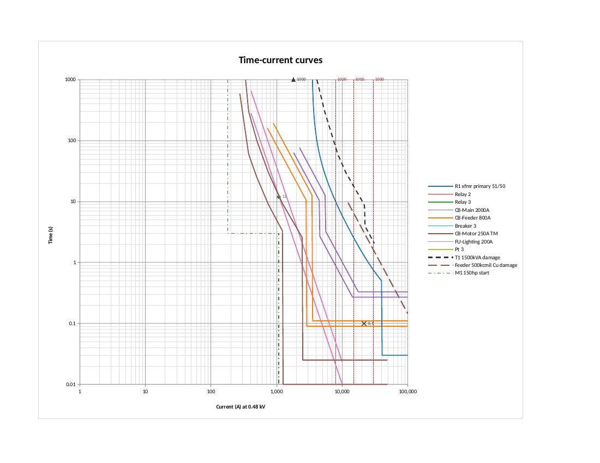

# Open TCC

A free Excel workbook that draws time-current curves (TCCs) for protective
device coordination, in the style of the Star module of ETAP. It has no macros:
every curve is an ordinary cell formula, so the plot updates as you change
settings.

The curve maths comes from public standards and manufacturer manuals. Nothing
is taken from ETAP, and this project is not affiliated with ETAP or Operation
Technology, Inc.



*The worked example, rendered by LibreOffice. In Excel the marker labels show
names (for example "T1 1500kVA inrush") instead of values.*

## Use it

Download `OpenTCC.xlsx` and open it in Microsoft 365.

| Sheet | Purpose |
|---|---|
| Devices | Settings for every device. Yellow cells are inputs. Set Enabled to Yes to plot a device. |
| TCC | The log-log plot, 1 A to 100 kA and 0.01 s to 1000 s, referred to the plot kV. |
| Coordination | Trip times at each fault current, and margins between device pairs you choose. |
| Lib_Relay | Relay curve constants. Add your own in the blank rows. |
| Lib_Points | Point tables for fuses and thermal-magnetic breakers. |
| Calc, Marks, Lib_Xfmr | Working sheets behind the plot. |

What it models:

- Overcurrent relays (51 with optional 50): IEEE, IEC and US inverse curves, definite time.
- LV breakers with electronic trip units: long-time, short-time (flat or I²t), instantaneous, with tolerance bands.
- Fuses and thermal-magnetic breakers, from point tables with log-log interpolation.
- Transformer through-fault damage curve, full-load and inrush markers.
- Cable short-circuit damage curve.
- Motor starting curve and safe stall point.
- Fault current markers.

See [docs/models.md](docs/models.md) for the equations and their sources.

## Limits

- The two point tables supplied are made-up shapes for demonstration. Enter
  points from the manufacturer's curve sheet for real devices.
- Curves are drawn on a grid of 100 points per decade, so vertical steps are
  drawn about 2 % wide. The Coordination sheet does not use the grid; it
  calculates times at the exact fault current.
- Ground-fault elements are not modelled separately. Enter one as a relay with
  a Definite Time curve.
- Unused device slots still appear in the legend. Click a legend entry and
  press Delete to remove it.
- The workbook has been checked by recalculating it in LibreOffice and
  comparing every curve cell with the Python reference. The chart has not yet
  been checked in Excel itself.
- This is an aid for study. Check settings against manufacturer data before
  applying them.

## Rebuild it

The workbook is generated by a script, so the repository stays reviewable.

```bash
pip install -r requirements.txt
```

```bash
python -m tcc.build OpenTCC.xlsx
```

```bash
python -m pytest
```

- `tcc/curves.py`: the curve maths, as plain Python.
- `tcc/model.py`: slot counts, defaults and the worked example.
- `tcc/build.py`: writes the workbook.
- `tcc/recalc.py`: recalculates a workbook with headless LibreOffice.

To change the number of device slots, edit `SLOTS` in `tcc/model.py` and
rebuild. The workbook test is skipped when LibreOffice is not installed.
